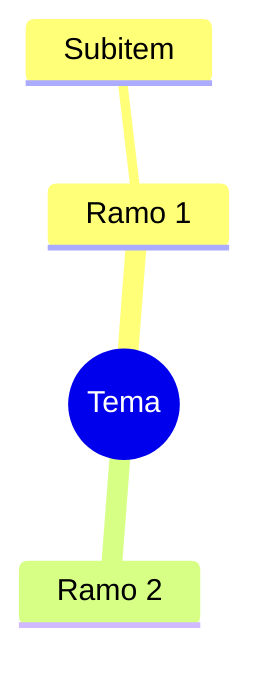

# Modelos de saída

## triagem
```
VEREDITO: AGIR | GUARDAR | DESCARTAR
Motivo (1-2 linhas):
Densidade útil: X% do material (o resto é repetição/senso comum)
Premissas frágeis / sem fonte:
Impacto no negócio (Projete BIM, INSS, contratos, comercial): sim/não, onde
Próximo passo:
```
Critérios: AGIR = muda uma decisão ou entrega nos próximos 30 dias. GUARDAR = útil, sem urgência, vale nota. DESCARTAR = redundante, genérico ou não verificável.

## resumo
```
Tese (2 linhas):
5 pontos que mudam o que eu faço:
1.
Afirmações sem fonte ou duvidosas:
O que o texto omite:
Uso prático (1 ação):
Conferir no original: [trechos]
```

## mapa

Máximo 4 ramos e 3 níveis. Abaixo do diagrama, liste as **relações entre ramos** (A condiciona B, C contradiz D).

## simulado
Para cada questão:
```
Q#. [nível 1-3] enunciado
(a) (b) (c) (d)
Gabarito: x
Justificativa:
Fonte/trecho:
Erro comum:
```
Regras: pelo menos 30% aplicação/cálculo; sem pegadinha de redação; exigir material-base para tema normativo. Após as respostas do usuário: corrigir, calcular acerto por tema e listar os 3 pontos fracos.

## revisao
Cartões:
```
P: ...
R: ...
Fonte: ...
```
Calendário de revisão: D+1, D+3, D+7, D+14, D+30. Reprogramar para D+1 o que errou. Máximo de 15 cartões por sessão.

## pesquisa
```
Pergunta delimitada:
Fontes (primárias/normativas primeiro): título | órgão/autor | data | link
Provado:
Opinião / mercado:
Desatualizado ou em disputa:
Lacunas:
Conclusão para a decisão:
```

## nota (segundo cérebro)
```markdown
---
titulo:
data: AAAA-MM-DD
tipo: estudo | triagem | pesquisa
fonte:
status: guardar | agir | revisado
tags: []
---
# Título
## Em uma frase
## Pontos-chave
## O que não é confiável
## Conexões (projetos, skills, normas)
## Ação
## Revisões: D+1 [ ] D+3 [ ] D+7 [ ] D+14 [ ] D+30 [ ]
```
